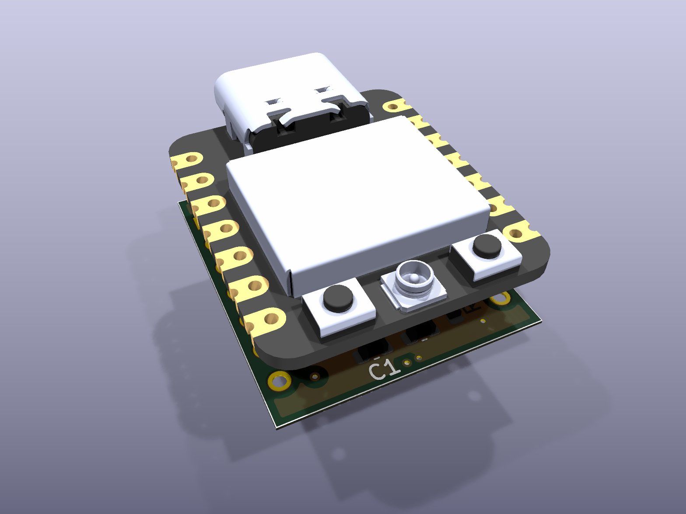
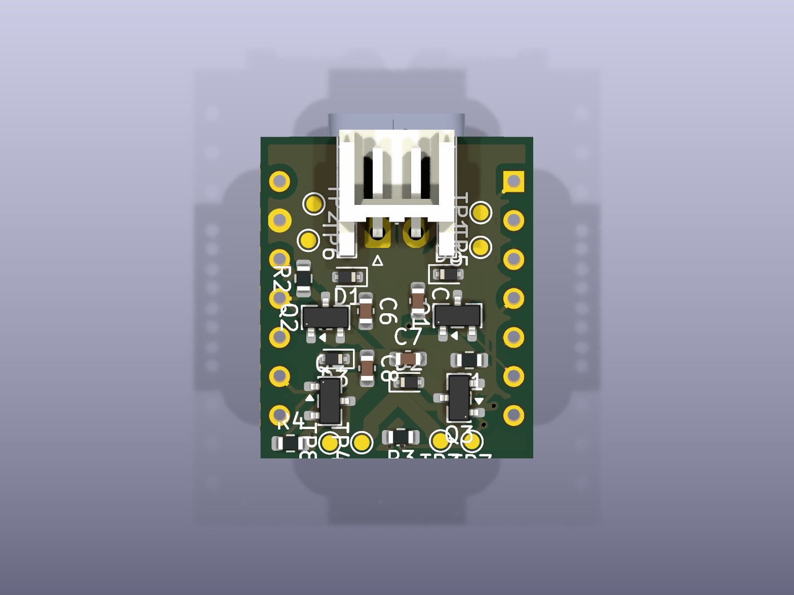
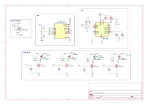

# Micro Drone Flight Controller

A compact 4-layer flight-controller PCB for micro drones, built around a **Seeed XIAO ESP32-S3** module, an **MPU-6050** IMU and four low-side MOSFET motor drivers for brushed (coreless) DC motors. The board measures about **17.75 x 20.95 mm** and is designed in KiCad 9.

<p align="center">
  
  
</p>

## Features

- ESP32-S3 (XIAO form factor) mounted on the board, with USB-C for programming
- MPU-6050 6-axis IMU on I2C
- 4 independent motor channels: AO3400A N-MOSFET low-side switch plus a 1N4148WT flyback diode per motor
- 2-pin JST-EH battery connector feeding the motor supply rail
- Test pads on every motor terminal, the battery rail and ground
- 4-layer stack-up: F.Cu / In1.Cu (power) / In2.Cu / B.Cu
- Fully custom symbol and footprint library (`Drone_prj`) and a 3D model for the XIAO module

## Hardware overview

| Item | Detail |
|---|---|
| MCU | Seeed XIAO ESP32-S3 (U1) |
| IMU | InvenSense MPU-6050, QFN-24 4x4 mm (U2), I2C address `0x68` (AD0 tied to GND) |
| Motor drivers | 4x AO3400A (Q1-Q4), SOT-23, low-side, with 1N4148WT flyback diodes (D1, D2, D3, D5) |
| Battery input | JST-EH 2-pin (J1) |
| Board size | about 17.75 x 20.95 mm |
| Layers | 4 |
| Tool | KiCad 9.0 |

### Pin map

| XIAO pin | Function |
|---|---|
| D0 | Motor 1 gate (Q1) |
| D10 | Motor 2 gate (Q2) |
| D3 | Motor 3 gate (Q3) |
| D8 | Motor 4 gate (Q4) |
| D4 | I2C SDA (MPU-6050) |
| D5 | I2C SCL (MPU-6050) |
| D1, D2 | Routed to the edge pads, not used by on-board circuitry |
| D6, D7, D9 | Not connected on the board |

The MPU-6050 interrupt pin is not connected to the MCU, so the IMU has to be polled.

### Motor connections

Each motor connects between a battery-rail pad and its switched drain pad:

| Motor | MOSFET | Switched pad |
|---|---|---|
| 1 | Q1 | TP5 |
| 2 | Q2 | TP6 |
| 3 | Q3 | TP7 |
| 4 | Q4 | TP8 |

Battery-rail pads are TP1-TP4 (and TP9); TP10 is ground.

### Power

The battery connector (J1) feeds the `BAT+` rail, which supplies the motors through the MOSFETs. The logic rail (`+3V3`) is taken from the XIAO module's 3V3 pin and supplies the MPU-6050.

## Schematic

[](docs/Mini_Drone_schematic.pdf)

The full schematic is also available as a [PDF](docs/Mini_Drone_schematic.pdf).

## Repository layout

```
hardware/         KiCad project: schematic, PCB, symbol/footprint library, 3D model
docs/             Schematic PDF and images used in this README
manufacturing/    Gerber + drill files (zip) and bill of materials
```

## Open the design

1. Install [KiCad](https://www.kicad.org/) 9 or newer.
2. Open `hardware/Mini_Drone.kicad_pro`.

The project-local library (`Drone_prj`) and the 3D model are referenced relative to the project folder, so no extra setup is needed.

## Manufacturing

`manufacturing/Mini_Drone_gerbers.zip` contains Gerber files for all four copper layers, solder mask, paste, silkscreen and board outline, plus the Excellon drill file. The bill of materials is in `manufacturing/Mini_Drone_bom.csv`.

## Design checks

Run with the KiCad 10 command-line tools on the files in `hardware/`:

- **ERC:** 0 errors, 2 warnings (one single-pin label, one unconnected wire end)
- **DRC:** no clearance, short or unconnected-item errors. The 12 reported errors are courtyard overlaps between other components and the XIAO module (U1) footprint area, a result of the compact layout. The remaining warnings are silkscreen overlaps/clipping and library-footprint overrides.

## Firmware

Firmware is not part of this repository yet.

## Author

Mohanraj D S - [github.com/MohanrajDS](https://github.com/MohanrajDS)
